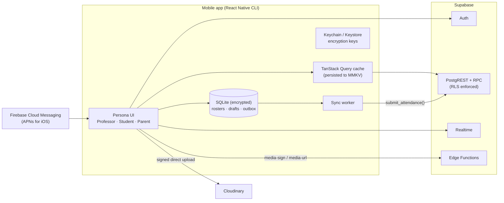
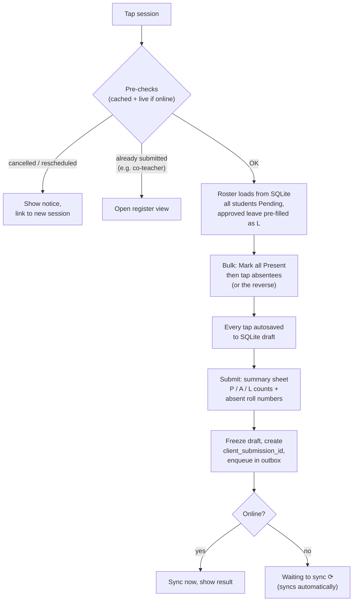
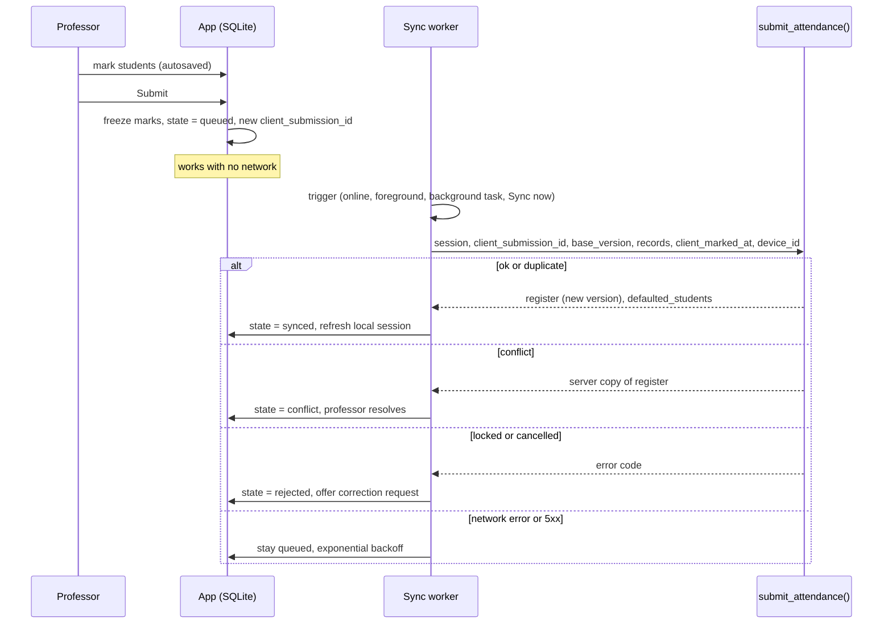

# Mobile Application Architecture

**Engineering College Attendance Management System: Single-Tenant Edition**

| | |
|---|---|
| Document | Mobile application architecture (Android and iOS) |
| Applies to | `MobileApp/mobile-app` (React Native CLI, bare project, no Expo) |
| Companion | [webapp_Architecture.md](webapp_Architecture.md), the source of truth for the **backend, data model, roles, attendance engine, notifications and jobs** |
| Inputs | *Feature Blueprint & Product Requirements (Single-Tenant)*, *Engineering College Hierarchy* (Mumbai University structure) |
| Stack | React Native CLI · TypeScript · NativeWind (Tailwind) · Supabase · Firebase Cloud Messaging · Cloudinary |
| Status | Draft v0.1, 2026-10-25 |

---

## 1. Purpose and scope

There is **one app in the stores** with three experiences. The interface is chosen from the signed-in user's role:

| Persona | Who | Core jobs |
|---|---|---|
| **Professor** | Teaching staff, plus extra features when they are a **Class Teacher** or **HOD** | Today's lectures, **mark attendance** (online or offline), timetable, class statistics, approve student leave, class announcements, staff leave |
| **Student** | Enrolled students | Attendance by subject and session, shortage status, timetable, exams, leave, notices, profile |
| **Parent / Guardian** | Verified guardians | A linked child's attendance and absences, timetable, exams, notices, queries. Switch between children |

Web-only roles (Principal, Admin, Operations, Exam Cell) see a "Use the web portal" screen. The exception is a user who also holds a mobile persona: an HOD signs in as a professor.

### 1.1 Goals

- A professor can mark a 70-student lecture in **under 30 seconds**, with or without connectivity.
- Students and parents see **accurate attendance** and know exactly where they stand against the threshold.
- **No user sees data outside their scope.** The server enforces this (RLS + RPC checks). The app only hides what the server would refuse anyway.
- The app runs well on **low-end Android phones** and patchy campus Wi-Fi or 4G.

---

## 2. System context



- The app calls **Supabase directly** through `supabase-js`. Next.js is not in the mobile path.
- Authorization is entirely server-side: RLS policies and checks inside RPCs (web doc §5 and §9).
- Business rules such as attendance calculation, locking and leave effects are implemented in Postgres (web doc §8). The app shows the results and uses `src/shared` (a synced copy of the web project's shared code) only for instant previews, such as "attend 4 more lectures to reach 75%".

---

## 3. Technology stack

| Concern | Choice | Why |
|---|---|---|
| Runtime | **React Native CLI**: bare project, latest stable React Native, New Architecture, Hermes | The repo owns the native `android/` and `ios/` projects. No Expo modules or services |
| Language | TypeScript `strict` | Zod schemas and helpers from the synced `src/shared/`. Generated database types in `src/types/database.ts` |
| Navigation | **React Navigation v7** (native stack + bottom tabs) | Persona switching by conditional navigators, typed param lists, `linking` config for deep links |
| Styling | **NativeWind** (Tailwind for React Native) | Same design tokens as the web app (`src/shared/tokens.ts` mapped into `tailwind.config.js`) |
| Lists | FlashList | Fast 70+ student rosters and long histories |
| Server state | **TanStack Query v5** + `persistQueryClient` | Caching, retries, offline reads, push-driven invalidation |
| Local UI state | Zustand | Active persona, marking session, UI preferences |
| Offline store | **op-sqlite** with SQLCipher enabled (Drizzle ORM optional) | Fast JSI-based SQLite. Durable rosters, drafts and the outbox. Encrypted at rest |
| Key-value storage | react-native-mmkv (encrypted instance) | Query-cache persistence, auth session, preferences |
| Secrets | **react-native-keychain** (iOS Keychain / Android Keystore) | Holds the MMKV and SQLCipher keys. Also stores biometric-protected items for the app lock |
| Backend client | `@supabase/supabase-js` | Auth, PostgREST, RPC, Realtime |
| Push | **@react-native-firebase/messaging** (FCM) + **Notifee** | FCM delivers to Android directly and to iOS through APNs. Notifee creates Android channels and shows notifications while the app is in the foreground |
| Connectivity | @react-native-community/netinfo | Sync triggers, offline banner |
| Background work | react-native-background-fetch | Uses Android WorkManager and iOS BGTaskScheduler. Best effort |
| Forms | React Hook Form + Zod | Shared schemas with web |
| Images | @d11/react-native-fast-image | Maintained FastImage fork. Disk-cached roster thumbnails |
| Files | react-native-image-picker, @react-native-documents/picker, @bam.tech/react-native-image-resizer, react-native-blob-util, react-native-share | Leave documents, upload progress, report downloads |
| Biometrics | react-native-keychain access control (biometry or device passcode) | Optional app lock with no extra library |
| Charts | victory-native (Skia) | Attendance trends |
| i18n | i18next + react-native-localize | English, Marathi, Hindi |
| Config | react-native-config | One `.env` per flavour, holding only public values (URLs, publishable key) |
| Monitoring | @sentry/react-native | Crashes, ANRs, performance traces, native symbol upload |
| Build / release | Gradle + Xcode, **Fastlane**, GitHub Actions | Firebase App Distribution and TestFlight for testers. Play Console and App Store for release |
| Testing | Jest + React Native Testing Library, Maestro | |

### 3.1 What the CLI choice means in practice

- **Native projects are part of the codebase.** Native libraries are added through autolinking. iOS dependencies need `bundle exec pod install`, with versions pinned in the `Gemfile`.
- **iOS builds need macOS with Xcode.** A Windows machine can build and run Android only. iOS builds need a Mac, or the macOS runner in CI ([§17](#17-build-release-and-updates)).
- **React Native upgrades are manual.** Use the React Native Upgrade Helper and plan one upgrade a year, during a semester break.
- **No over-the-air updates in v1.** JavaScript fixes ship as store releases. Microsoft retired CodePush with App Center in March 2025. If OTA becomes necessary, a self-hosted tool such as hot-updater, which can use Supabase as its backend, can be added later without changing this architecture.
- **Separate project.** The app is a standalone project in `MobileApp/mobile-app` with its own `package.json` and lockfile. It does not import anything from the web project at build time:
  - Shared TypeScript is a synced copy in `src/shared/`, updated with `npm run sync:shared`.
  - Database types are generated into `src/types/database.ts`.

  See web doc §4.
- **Short path with no spaces.** Android native (CMake) builds and some iOS build scripts can fail on paths with spaces, and Windows limits paths to 260 characters. Keep the project at a path such as `F:\Projects\college-attendance-system\MobileApp\mobile-app`.

---

## 4. Project structure

```
MobileApp/mobile-app/
├── android/                            # native Android project: Gradle product flavours, signing,
│                                       # google-services.json per flavour, deep-link intent filters
├── ios/                                # native iOS project: scheme + configuration per variant, Podfile,
│                                       # GoogleService-Info.plist per config, Push + Background Modes
├── src/
│   ├── App.tsx                         # providers (Query, theme, i18n) + NavigationContainer
│   ├── navigation/
│   │   ├── RootNavigator.tsx           # auth / persona switch (below)
│   │   ├── AuthNavigator.tsx           # SignIn, ForgotPassword (SetPassword is at the root)
│   │   ├── ProfessorNavigator.tsx      # tabs: Today · Timetable · Classes · Inbox · More + stack
│   │   ├── StudentNavigator.tsx        # tabs: Home · Attendance · Timetable · Leave · More + stack
│   │   ├── ParentNavigator.tsx         # tabs: Home · Attendance · Schedule · Notices · More + stack
│   │   ├── linking.ts                  # deep-link config (collegeapp:// + App Links / Universal Links)
│   │   └── types.ts                    # typed param lists for every navigator
│   ├── screens/
│   │   ├── auth/
│   │   ├── professor/                  # Today, Timetable, Classes, Inbox, More, MarkAttendance,
│   │   │                               # Register, CorrectionRequest, ClassDetail, LeaveApproval,
│   │   │                               # StaffLeave, NewAnnouncement
│   │   ├── student/                    # Home, Attendance, SubjectDetail, Timetable, Leave, NewLeave,
│   │   │                               # LeaveDetail, Dispute, Profile, More
│   │   ├── parent/                     # Home, Attendance, Schedule, Notices, ChildSwitcher, NewQuery, More
│   │   └── shared/                     # Notifications, PersonaSelect, UpdateRequired, UseWebPortal
│   ├── features/                       # attendance, timetable, leave, notices, exams, profile…
│   │   └── attendance/{api.ts, hooks.ts, components/}
│   ├── offline/                        # SQLite schema + migrations, prefetch, outbox, sync engine
│   ├── lib/
│   │   ├── supabase.ts                 # client with encrypted storage adapter
│   │   ├── query-client.ts             # TanStack Query + persistence
│   │   ├── storage.ts                  # MMKV + Keychain key management
│   │   ├── push.ts                     # FCM permission + token, Notifee channels, message handlers
│   │   ├── config.ts                   # typed wrapper over react-native-config
│   │   └── i18n.ts
│   ├── components/                     # design-system components
│   ├── stores/                         # Zustand: session, persona, marking
│   ├── shared/                         # synced copy of Webapp/web-app/src/shared (never edited here)
│   └── types/database.ts               # generated by `supabase gen types`
├── scripts/sync-shared.mjs             # copies shared code from the web project
├── fastlane/                           # Fastfile: beta and release lanes for both platforms
├── .env.development                    # public values only (Supabase URL, publishable key,
├── .env.staging                        #   Cloudinary cloud name); secrets never ship in the app
├── .env.production
├── metro.config.js                     # NativeWind
├── babel.config.js
├── Gemfile                             # pins CocoaPods and Fastlane versions
└── package.json
```

The root navigator chooses the screen tree from the session and the active persona:

```tsx
// src/navigation/RootNavigator.tsx
const Stack = createNativeStackNavigator<RootStackParamList>();

export function RootNavigator() {
  const { session, persona } = useAuth();

  return (
    <Stack.Navigator screenOptions={{ headerShown: false }}>
      {!session ? (
        <Stack.Screen name="Auth" component={AuthNavigator} />
      ) : persona === 'professor' ? (
        <Stack.Screen name="Professor" component={ProfessorNavigator} />
      ) : persona === 'student' ? (
        <Stack.Screen name="Student" component={StudentNavigator} />
      ) : persona === 'parent' ? (
        <Stack.Screen name="Parent" component={ParentNavigator} />
      ) : persona === 'choose' ? (
        <Stack.Screen name="PersonaSelect" component={PersonaSelectScreen} />
      ) : (
        <Stack.Screen name="UseWebPortal" component={UseWebPortalScreen} />
      )}
      <Stack.Screen name="UpdateRequired" component={UpdateRequiredScreen} />
    </Stack.Navigator>
  );
}
```

This is React Navigation's recommended auth-flow pattern: screens are defined conditionally. When the session or persona changes, the whole tree is replaced, so the back button can never return to another persona's screens.

---

## 5. Authentication and personas

### 5.1 Sign-in methods

| Persona | Method | Notes |
|---|---|---|
| Professor | Email + password (Google sign-in if the college uses Google Workspace) | Account provisioned by Ops. First login comes from an invite link that sets a password |
| Student | Email + password | Provisioned by Ops at import. Invite link sets the password |
| Parent | Email + password | Account provisioned by Ops on the guardian record. Invite link sets the password. Access covers only children whose `guardian_links` are **verified** |

- **There is no self-registration.** Parent access exists only through `guardian_links` that Ops has verified. Knowing an enrollment number or PRN grants nothing.
- Password reset and invite links open the app through deep links (`set-password`). On devices without the app installed they fall back to a small web page.

### 5.2 Session storage

```ts
// lib/supabase.ts (simplified)
export const supabase = createClient<Database>(SUPABASE_URL, SUPABASE_PUBLISHABLE_KEY, {
  auth: {
    storage: encryptedMmkvStorage,   // MMKV encrypted with a key kept in Keychain / Keystore
    autoRefreshToken: true,
    persistSession: true,
    detectSessionInUrl: false,
  },
});

// refresh tokens only while the app is in the foreground
AppState.addEventListener('change', (s) =>
  s === 'active' ? supabase.auth.startAutoRefresh() : supabase.auth.stopAutoRefresh(),
);
```

**Sign-out is guarded.** If the outbox holds unsynced registers, the app blocks sign-out and offers "Sync now". Otherwise it:

1. Deletes the device-token row.
2. Calls `signOut()`.
3. Clears the query cache, SQLite, MMKV and the image cache.

### 5.3 Persona resolution

The JWT carries `app_roles` plus `staff_id`, `student_id` and `guardian_id` from the custom access-token hook (web doc §5.5).

```
roles ∩ {professor, hod}  → Professor persona
student                   → Student persona
parent                    → Parent persona
only web roles            → "Use the web portal" screen
more than one persona     → persona picker (e.g. a professor whose child studies at the college),
                            switchable from More; last choice remembered
```

Extra professor capabilities come from the `my_capabilities()` RPC: Class Teacher of Division X, HOD of Department Y, and exam duties. They switch features on, such as the approvals inbox and the department submission summary.

### 5.4 Launch and foreground checks

1. Read `app_config`. If the installed version is below `min_mobile_version`, show the blocking **update-required** screen. Show the maintenance banner if one is set.
2. Validate the session. If the account was deactivated, sign out with a message.
3. Re-register the push token if it changed.
4. Kick the **sync worker** ([§9](#9-offline-first-attendance)).
5. Refresh the prefetch window if it is more than an hour old.
6. If enabled, show the biometric or PIN unlock. This is optional for professors and can be required by college policy.

---

## 6. Navigation by persona

| Persona | Bottom tabs | Header |
|---|---|---|
| Professor | **Today** · Timetable · Classes · Inbox · More | Sync status badge, notification bell |
| Student | **Home** · Attendance · Timetable · Leave · More | Notification bell |
| Parent | **Home** · Attendance · Schedule · Notices · More | **Child switcher**, notification bell |

### 6.1 Feature-to-screen mapping

**Professor (Blueprint §3)**

| Blueprint feature | Screen |
|---|---|
| Today's timetable, upcoming lectures, pending submissions, history | Today |
| Mark Present / Absent / other statuses, bulk + individual, draft, submit, confirm | Session → Mark |
| Whole-division theory and batch practical attendance | Session → Mark (roster comes from the teaching group) |
| Offline entry and safe sync | Mark + sync worker + Today sync badges |
| Warn if cancelled / rescheduled / already marked | Session → Mark (pre-checks) |
| View submitted register | Session → Register |
| Daily / weekly / semester timetable, filter by session type, rooms, substitutes | Timetable |
| Subject percentages, students nearing shortage, submission completion | Classes → Class |
| Staff leave and approval history | More → Staff leave |
| Approve or reject student leave (as Class Teacher) | Inbox → Approvals |
| Announcements to assigned classes | More → New announcement |
| Repeated-absence and activity alerts | Inbox, Notifications |

**Student (Blueprint §4)**

| Blueprint feature | Screen |
|---|---|
| Overall and subject-wise %, attended / absent / excused / held | Home, Attendance |
| Today's timetable, exams, practical/viva schedule | Home, Timetable, More → Exams |
| Shortage warnings, eligibility, remaining requirement | Home banner, Attendance → Subject |
| Per-session status and submission time, theory vs practical | Attendance → Subject |
| Report incorrect attendance | Attendance → Subject → session → "Report a problem" |
| Trends over a period | Attendance → Subject (chart) |
| Full-day / half-day / session leave with documents, track, cancel | Leave |
| Profile, enrollment no, PRN, branch, year, semester, division, batch, subjects | More → Profile |
| Faculty and class-teacher details | More → My faculty |
| IA and end-sem timetables, results / report cards (if enabled) | More → Exams, More → Results |
| Academic calendar and holidays | More → Calendar |
| Download attendance reports, previous semesters | More → Downloads, Attendance (term picker) |
| Request corrections to official records | More → Profile → Request correction |

**Parent (Blueprint §5)**

| Blueprint feature | Screen |
|---|---|
| Verified links to one or more students, switch without logging out | Child switcher |
| Overall, subject-wise and practical attendance | Home, Attendance |
| Absence alerts with date, subject and session | Notifications → Absence detail |
| Shortage, daily/weekly summary, repeated-absence alerts, correction notices | Notifications |
| Timetable, calendar, exams, published results | Schedule |
| Approved leave, attendance history | Attendance → History |
| Messages from college and class teacher, official notices | Notices |
| Queries about attendance discrepancies | Attendance → session → "Ask about this" |
| Notification preferences, contact updates, notification history | More |

---

## 7. Data layer

### 7.1 Principles

- **Narrow, purpose-built endpoints.** Mobile reads views and RPCs that return only the columns a screen needs. RLS still applies to every one of them.
- **TanStack Query** owns server state. Query keys always include the scope, for example `['attendance', 'summary', studentId, termId]`. Switching child or persona therefore never shows another person's cached data.
- **Persisted cache.** Queries are written to encrypted MMKV, so the app opens instantly with the last data and a "Last updated 10:42" hint.
- **Push-driven invalidation.** Notification payloads include `invalidate` keys, so a timetable change refreshes the timetable query when the app is open.
- **Realtime only where it pays:** the notification badge, and the open register so a co-teacher's submission is shown immediately. Everything else uses pull plus push invalidation.
- **Errors.** Postgres error codes (`ATT_LOCKED`, `LEAVE_OVERLAP` …) are mapped to localised messages from `src/shared/errors.ts`.

### 7.2 Freshness

| Data | Stale time | Also refreshed on |
|---|---|---|
| Professor sessions (prefetch window) | 15 min | Foreground, pull-to-refresh, `timetable_changed` push |
| Session roster | 12 h | Opening the marking screen when online |
| Attendance summaries | 5 min | `attendance_published` / `attendance_corrected` push |
| Timetable | 12 h | `timetable_changed` push |
| Notices / notifications | 1 min | Realtime badge |
| Profile, faculty, calendar | 24 h | Pull-to-refresh |

### 7.3 Backend contract per persona

All endpoints are defined in the shared backend (web doc §8–§9). `v_` = RLS-protected view, `rpc` = Postgres function, `ef` = Edge Function.

| Persona | Operation | Endpoint |
|---|---|---|
| Professor | Sessions in a date window | `v_my_sessions` |
| | Roster for marking (with leave hints, photo URLs) | `rpc session_roster_for_marking(session_id)` |
| | Submit or edit attendance | `rpc submit_attendance(...)` |
| | Submitted register | `v_register_detail` |
| | Class statistics and shortage list | `rpc class_attendance_stats(group_id, term_id)` |
| | Correction request after lock | `rpc request_attendance_correction(...)` |
| | Leave approvals (class teacher) | `v_leave_pending_for_me`, `rpc decide_leave(...)` |
| | Staff leave | `rpc apply_staff_leave(...)`, `v_my_staff_leave` |
| | Class announcement | `rpc create_class_announcement(...)` |
| | Capabilities | `rpc my_capabilities()` |
| Student | Summary | `v_my_attendance_summary` |
| | Subject detail (sessions, trend, requirement) | `rpc my_subject_attendance(offering_id)` |
| | Timetable, exams, calendar | `v_my_timetable`, `v_my_exams`, `v_academic_calendar` |
| | Leave | `rpc apply_leave(...)`, `rpc cancel_leave(id)`, `v_my_leave` |
| | Dispute a record | `rpc raise_attendance_dispute(record_id, message)` |
| | Profile, faculty | `v_my_profile`, `v_my_faculty` |
| Parent | Linked children | `v_my_children` (verified links only) |
| | Child data | Student views and RPCs with an explicit `student_id`, each checked by `app.is_guardian_of()` |
| | Query to class teacher | `rpc raise_guardian_query(student_id, record_id?, message)` |
| All | Notifications feed, mark read | `notifications` (RLS: own rows), `rpc mark_notifications_read(ids)` |
| | Notification preferences | `notification_preferences` (RLS: own rows) |
| | Register push token | `rpc register_device(token, platform, app_version, device_id)` |
| | Upload signature, private file URL | `ef media-sign`, `ef media-url` |

---

## 8. Professor experience

### 8.1 Today screen

- One card per session, showing time, subject, component (TH, PR or TUT), division or batch, and room.
- Each card shows one status: **Upcoming**, **Mark now**, **Submitted ✓**, **Waiting to sync ⟳**, **Needs attention ⚠** (conflict, rejected, or students defaulted to absent), **Cancelled**, **Rescheduled**, or **Substitute**.
- A summary strip shows pending registers today and overdue registers from previous days. Tapping it opens the list.

### 8.2 Marking flow



**Marking screen design:**

- **Header:** subject, group, time, and live counters (`P 0 · A 0 · L 2 · Pending 68`).
- **Two layouts.** A **list** shows roll number (large), name and an optional photo thumbnail. A **grid** shows roll-number tiles and is the fastest way to tap a few absentees. Search jumps to a roll number.
- **Taps.** A tap toggles P ⇄ A. A long-press opens other statuses the professor may set (`professor_can_set`, e.g. OD).
- **Leave.** Students on approved leave show an **On leave** badge with `L` pre-filled. The professor can change it to `P` if the student is actually present.
- **Unmarked students** stay *Pending*. On submit, the confirmation sheet says how many pending students will become *Absent* under college policy.
- **Duplicate prevention.** The Submit button disables while a submission is in flight. The idempotency key ([§9.3](#93-sync-algorithm)) makes retries safe anyway.
- **Time window.** Marking opens N minutes before the session starts (configured in `app_config`). Late submissions are allowed until the lock and are flagged as late on the web dashboards.
- **After submission**, the professor can edit until the edit window closes. After lock, the register is read-only and offers **Request correction**.

### 8.3 Classes, approvals and HOD summary

- **Class view:** each student's percentage for this subject and component, with colour bands for below minimum and below warning. Also sessions held vs scheduled and submission completion.
- **Class Teacher:** an approvals inbox with approve, reject or request more information. Includes a division attendance overview and repeated-absence alerts.
- **HOD:** a read-only department summary (submission status, shortage counts). Full HOD tools are on the web.

---

## 9. Offline-first attendance

This section implements the blueprint's *Attendance integrity* rule: offline sync must resolve duplicate submissions and conflicting edits safely.

### 9.1 What works offline

| Capability | Offline | Window |
|---|---|---|
| Professor's sessions and timetable | ✓ | Today − 2 days … today + 7 days |
| Rosters (name, roll no, thumbnail, leave hints) for those sessions | ✓ | Same window |
| **Marking, saving drafts, submitting (queued)** | ✓ | |
| Own submitted registers | ✓ (read) | Last 14 days |
| Student and parent summaries, timetable | ✓ (read, last fetched) | |
| Leave application, disputes, uploads, approvals | ✗ (needs network, drafts are kept) | |

### 9.2 Local schema (SQLite, SQLCipher-encrypted)

```sql
-- prefetched reference data
create table local_sessions (
  id text primary key, starts_at text, ends_at text, subject_name text,
  component text, group_label text, room text, status text,
  register_state text, register_version integer, fetched_at text
);
create table local_roster (
  session_id text, student_id text, roll_no text, name text,
  photo_url text, suggested_status text,
  primary key (session_id, student_id)
);

-- professor's work
create table local_registers (
  session_id text primary key,
  state text not null,            -- draft | queued | syncing | synced | conflict | rejected
  client_submission_id text,      -- set when Submit is tapped, reused on every retry
  base_version integer,           -- server version this draft started from
  defaulted_students text,        -- JSON returned by server (students auto-marked absent)
  last_error text, updated_at text
);
create table local_marks (
  session_id text, student_id text, status_code text, marked_at text,
  primary key (session_id, student_id)
);

-- outbox (FIFO)
create table outbox (
  id integer primary key autoincrement,
  kind text not null,             -- 'submit_attendance' (extensible)
  session_id text, client_submission_id text, payload text,
  attempts integer default 0, next_attempt_at text, created_at text
);
```

Schema migrations are versioned in `src/offline/migrations` and run at startup. The database key is generated on first launch and stored in the Keychain / Keystore through react-native-keychain. SQLCipher is switched on through op-sqlite's `sqlcipher` option in `package.json`.

### 9.3 Sync algorithm



**Rules:**

1. **Idempotency.** The `client_submission_id` (a UUID) is generated *when Submit is tapped* and written to SQLite *before* the first network call. Every retry reuses it, and the server returns the stored result for a repeat. A flaky network therefore never produces a duplicate submission.
2. **Edits after a successful sync** start a new draft from the synced data, with `base_version` set to the synced version, and get a new submission ID.
3. **One worker at a time** (single-flight lock). The outbox is processed in FIFO order. Backoff runs from 5 s up to 15 min. "Sync now" resets the backoff.
4. **Server time is authoritative** for `submitted_at`, lateness and lock decisions. The device's `marked_at` and `client_marked_at` are stored for audit. A clock skew above 5 minutes is flagged on the register.
5. **Lock still applies offline.** If the register locked before the device reconnected, the server rejects the submission. The app turns the queued marks into a **correction request** with a reason prompt, so the professor's work is never lost.
6. **Roster drift.** If students joined the group after the roster was downloaded, the server gives them the default unmarked status and lists them in `defaulted_students`. The session card then shows **Needs attention** with a one-tap review.
7. **Sign-out and data-wipe guard.** The app refuses to clear local data while the outbox is not empty. Unsynced counts appear on the Today tab badge.

**Conflict resolution screen.** This appears, for example, when a co-teacher or substitute submitted the same register first. It shows the server register and the local marks side by side, with differences highlighted, and offers three options:

- **Keep server version** discards the local marks.
- **Submit mine as an edit** is available only inside the edit window. It resubmits with the new `base_version`, and each changed record is audited.
- **Request correction** is used after lock.

### 9.4 Prefetch

The app prefetches at sign-in, on foreground (if the last fetch is more than an hour old), on pull-to-refresh, and opportunistically through `react-native-background-fetch` (best effort, around 06:30; the OS decides the exact time). It downloads:

- Sessions in the window, rosters and leave hints into SQLite
- Roster thumbnails into the FastImage disk cache
- Status codes and the professor's capabilities

---

## 10. Student experience

- **Home:**
  - A ring showing overall percentage, plus theory and practical percentages.
  - A **shortage banner**, for example "Below 75% in DBMS (Theory). Attend the next 4 lectures to recover", or "Cannot reach 75% this term in …" when the remaining sessions are not enough.
  - Today's timetable, upcoming exams and the latest notices.
- **Attendance:**
  - A subject list with TH, PR and TUT percentages and held / attended / absent / excused counts. A term picker gives access to previous semesters, read-only.
  - **Subject detail:** a session-by-session list (date, time, type, status, submission time), a calendar heatmap, a trend chart over a selected period, and the remaining-requirement calculation.
  - Every session row has **Report a problem**, which opens a dispute thread with the professor.
- **Timetable:** day and week views with a session-type filter. Changes and cancellations are highlighted.
- **Leave:**
  - Apply for a full day, half day or selected sessions, with a reason and an optional document (camera or PDF).
  - The app checks locally for overlaps before submitting. The server's exclusion constraint is authoritative.
  - Track status, cancel while pending, and see the decision and note.
- **More:** profile (enrollment no, PRN, branch, year, semester, division, batch, enrolled subjects), faculty and class teacher, exams (IA and end-sem), results and report cards (if enabled), calendar and holidays, downloads (attendance report PDF), notification settings, language, sign out.

---

## 11. Parent experience

- **Child switcher** in the header. It lists only **verified** links from `v_my_children` and remembers the last selection. Switching changes the `studentId` in every query key, so caches never mix.
- **Home:**
  - Today's status so far, for example "Present in 3 of 4 marked lectures; absent in DBMS 10:00".
  - Overall percentage.
  - Active alerts, such as shortage or repeated absence.
- **Attendance:**
  - Subject-wise and practical percentages.
  - An absence list with date, subject and session.
  - Approved leave and full history.
- **Schedule:** timetable, exams, academic calendar and published results.
- **Notices:** college announcements and class-teacher messages.
- **Queries:** "Ask about this absence" opens a thread with the class teacher, linked to the record.
- **More:**
  - **Notification preferences:**
    - Instant absence alerts or a daily digest (18:30)
    - Shortage and summary alerts
    - SMS and WhatsApp, when the college enables them
  - Notification history.
  - Update contact details. Phone changes go to Ops for re-verification.
  - Language: English, Marathi or Hindi.

---

## 12. Notifications

- **Native setup:**
  - A Firebase project has Android and iOS apps registered for each flavour.
  - The **APNs auth key (.p8)** is uploaded to Firebase, so FCM can deliver to iOS.
  - In Xcode, the iOS target has the *Push Notifications* capability and *Background Modes → Remote notifications* enabled.
- **Permission prompt** comes after sign-in, with a short explanation screen first ("Get alerted when attendance is marked"), not on first launch. The app calls `messaging().requestPermission()` on iOS and requests the `POST_NOTIFICATIONS` runtime permission on Android 13+.
- **Token registration:**
  - `messaging().getToken()` → `rpc register_device(...)`.
  - Re-registered from `messaging().onTokenRefresh` and on app upgrade.
  - Deleted on sign-out with `messaging().deleteToken()` and the device-token row removed.
- **Message handling:**
  - Foreground: `messaging().onMessage` → Notifee displays the notification and invalidates queries.
  - Background or killed: `messaging().setBackgroundMessageHandler` in `index.js`.
  - Taps: `getInitialNotification()` and `onNotificationOpenedApp()` for FCM, plus Notifee press events. All of them route through the deep-link handler.
- **Android channels:** `attendance` (high), `exams` (high), `reminders` (default), `announcements` (default). Notifee creates them at startup, and users can tune each one in system settings.
- **Payload contract:**

The server sends this through the FCM HTTP v1 API. All `data` values must be strings, so `invalidate` is comma-separated.

```json
{
  "message": {
    "token": "<fcm registration token>",
    "notification": {
      "title": "Absent: DBMS (Theory)",
      "body": "Roll 23 was marked absent on 25 Oct, 10:00–11:00."
    },
    "data": {
      "type": "student_marked_absent",
      "url": "collegeapp://parent/attendance/session/9f1c…",
      "studentId": "…",
      "invalidate": "attendance",
      "notificationId": "…"
    },
    "android": { "priority": "high", "notification": { "channel_id": "attendance" } },
    "apns": { "payload": { "aps": { "sound": "default" } } }
  }
}
```

- **Deep links.** React Navigation's `linking` config resolves `data.url` and the `collegeapp://` scheme. Invite and password-reset links use Android App Links and iOS Universal Links. These need an intent filter in `AndroidManifest.xml`, the Associated Domains entitlement on iOS, and `assetlinks.json` and `apple-app-site-association` files hosted on the college domain. If a link targets another persona (a multi-persona user), the app switches persona first. Unknown or unauthorised routes fall back to the notification centre.
- **The notification centre is the source of truth.** It reads the `notifications` table, and push is only a delivery channel. A missed or blocked push never means a missed notice.
- Server-side events, dedupe keys, quiet hours and digests are covered in web doc §13.

| Persona | Notifications received |
|---|---|
| Professor | Register missing / reminder, timetable change, session cancelled, substitute assignment, leave approval pending (class teacher), repeated-absence alerts, exam schedule and duties, announcements |
| Student | Attendance published, attendance corrected, shortage warning, leave decision, timetable change, exam schedule, announcements |
| Parent | Child marked absent (instant or digest), shortage warning, repeated absence, attendance corrected, leave decision, exam schedule, announcements, class-teacher messages |

---

## 13. Media and files

- **Roster photos:**
  - Signed Cloudinary thumbnail URLs (96 × 96, `f_auto,q_auto`) come back from the roster RPC.
  - FastImage caches them in memory and on disk.
  - Cleared on sign-out.
  - Photos can be switched off college-wide through `app_config`.
- **Uploads** (leave documents, and profile photos if the college allows them):
  1. Pick or capture the file.
  2. Compress images (max 1600 px, JPEG quality 0.7).
  3. Get a signature from `ef media-sign` (purpose, entity).
  4. Upload directly to Cloudinary with a progress bar.
  5. Call `rpc register_media`.
  6. Attach the asset to the request.
- **Downloads** (attendance report PDF, timetable or exam PDFs): `ef media-url` returns an expiring URL. The app downloads it with react-native-blob-util and opens or shares it with react-native-share.

---

## 14. UI system

- **NativeWind** maps the synced design tokens (`src/shared/tokens.ts`) into `tailwind.config.js`, so colours, spacing and typography match the web. Attendance status colours come from the server's `attendance_status_codes`.
- **Core components:**
  - Layout and controls: `Button`, `Card`, `Sheet`, `EmptyState`
  - Attendance: `StatusPill`, `RosterRow`, `RosterTile`, `PercentRing`, `SessionCard`
  - Sync state: `SyncBadge`, `OfflineBanner`
- **Accessibility:**
  - Touch targets of at least 48 dp. This matters for roster tiles.
  - Dynamic type support.
  - Screen-reader labels, for example "Roll 23, Absent. Double-tap to mark present".
  - **Status is never shown by colour alone.** Every status also carries a letter (P, A, L, OD).
- **Light and dark** themes follow the system setting.
- **i18n.** English is the default. **Marathi and Hindi** come first on parent screens. Dates use the `25 Oct 2026` format and times use a 12-hour clock in IST.
- **Low-end Android:** minimal animation, no heavy shadows on long lists, Hermes and FlashList.

---

## 15. Security

| Concern | Measure |
|---|---|
| Tokens | Supabase session in encrypted MMKV. Keys in Keychain / Keystore via react-native-keychain |
| Offline personal data | SQLCipher-encrypted SQLite. Prefetch window kept small (− 2 / + 7 days) |
| App secrets | None in the bundle. Only the Supabase URL, the **publishable (anon) key** (safe because of RLS) and the Cloudinary cloud name |
| Authorization | Server-side only (RLS + RPC checks). The app never decides access |
| Parent access | Only verified `guardian_links`. Each request carries `student_id` and the server checks it |
| Logs and crash reports | Sentry `beforeSend` scrubber removes names, phone numbers, roll numbers and tokens |
| Deactivated accounts | Forced sign-out and local wipe at the next launch or foreground |
| Shared or lost devices | Optional biometric or PIN lock with an inactivity timeout. Ops can revoke sessions from the web |
| Deep links | Allow-listed routes only. Auth tokens are handled only through Supabase's own flows |

---

## 16. Performance targets

| Metric | Target |
|---|---|
| Cold start to usable Today screen (mid-range Android) | < 2.5 s, rendered from the persisted cache |
| Open the marking screen for a 75-student roster | < 500 ms from SQLite |
| Tap-to-feedback on a roster row | < 50 ms (per-student Zustand state, memoised rows, FlashList) |
| Submit to synced (online) | < 2 s at p95 |

Other measures:

- Narrow views instead of `select *`.
- Paginated histories.
- 96 px thumbnails instead of full photos.
- Icons imported individually to keep the bundle small.

---

## 17. Build, release and updates

- **Build variants** are native flavours. Each one has its own app ID, display name, icon badge, `.env` file (react-native-config) and Firebase config file:

| Variant | Android | iOS | Backend | Distribution |
|---|---|---|---|---|
| `development` | `dev` product flavour, debug build | `Dev` scheme / configuration | Local or staging Supabase | Developers (Metro) |
| `staging` | `staging` product flavour, release build | `Staging` scheme | Staging | Firebase App Distribution / TestFlight |
| `production` | `prod` product flavour, release AAB | `Release` scheme | Production | Play Store / App Store |

- **Signing.** None of these signing assets are stored in git:
  - The Android upload keystore lives in GitHub secrets, and Play App Signing holds the final Android signing key.
  - iOS certificates and provisioning profiles are managed with Fastlane `match` in a private, encrypted repository.
- **CI/CD (GitHub Actions + Fastlane):**
  - Pull request: typecheck, lint, Jest.
  - `main`: build Android `bundleStagingRelease` on an Ubuntu runner and iOS (`gym`) on a **macOS runner**, then upload to Firebase App Distribution and TestFlight.
  - Release tag: `supply` uploads to the Play internal track, `deliver` uploads to App Store Connect, and source maps plus native debug symbols go to Sentry.
- **No OTA updates in v1.** Every change ships as a store release ([§3.1](#31-what-the-cli-choice-means-in-practice)). The force-update gate below covers urgent fixes.
- **Backend compatibility:**
  - RPCs are versioned (`_v2`) for breaking changes.
  - `app_config.min_mobile_version` gates very old builds.
  - The previous app version is supported for at least one term.
- **Store requirements:**
  - Privacy policy URL.
  - Play *Data safety* form and Apple privacy labels, declaring name, phone, photos, education records and device identifiers.
  - Review demo accounts for each persona on a sandboxed demo student.
  - An in-app **account deletion request** that routes to Ops. Academic records are retained as the law requires, and the app explains this.
- **Ownership.** As part of the single-tenant handover, the college owns:
  - The Apple Developer, Google Play Console and Firebase accounts.
  - The Android upload keystore.
  - The iOS signing certificates.
- **Rollout:**
  1. Internal testing.
  2. Pilot with one department for two weeks.
  3. Staged Play rollout (10% → 50% → 100%) and App Store phased release.

---

## 18. Observability

- **Sentry:** crashes, ANRs, slow frames, and traces for `open-marking`, `submit` and `sync`.
- **Sync telemetry events** carry no personal data: outbox length, time-to-sync, conflict, rejection and defaulted-student rates, and app version. They feed the web operational health panel.
- **No third-party ad or marketing SDKs.**

---

## 19. Testing

| Layer | Tool | Focus |
|---|---|---|
| Sync engine | Jest | State machine against mocked RPC results: ok, duplicate, conflict, locked, cancelled, network flake, **app killed mid-sync**, clock skew |
| Components | Jest + RNTL | Marking screen (bulk, toggle, long-press, leave badge, counters), child switcher scoping |
| Backend contract | Jest against local Supabase | Each persona's endpoints return only in-scope data (complements pgTAP in the web doc) |
| End-to-end | **Maestro** | Per-persona flows on an Android emulator and iOS simulator. **Airplane-mode test:** mark offline, kill the app, reconnect, register synced exactly once |
| Device matrix | Physical devices | Low-end Android (2–3 GB RAM, Android 10+), a mid-range Android, a recent iPhone, the oldest supported iOS |

---

## 20. Delivery phases (mobile)

| Phase | Mobile scope |
|---|---|
| **01 Foundation** | Native project setup (flavours, signing, Firebase, Fastlane CI), app shell, design system, auth for all three personas, persona routing, profile, timetable (read) |
| **02 Core attendance** | Professor marking with SQLite draft autosave, submit / edit / register view, **idempotent submission IDs from day one**. Student and parent attendance views. Basic push |
| **03 Academic operations** | Student leave and class-teacher approvals, staff leave, announcements, notification centre and preferences, exams, disputes and queries, parent digest |
| **04 Production readiness** | Full offline outbox + background sync + conflict UI, SQLCipher, charts and trends, Marathi and Hindi, optional QR, store release and staged rollout |

Phase 02 builds attendance submission on the idempotent RPC and the SQLite draft from the start. Phase 04 then adds the queue, background triggers and conflict screens without reworking the data path.

---

## 21. Future modules

- **QR attendance verification** (blueprint §8):
  - The professor taps *Start QR*, and the server issues a short-lived per-session secret to that device.
  - The professor's screen shows a **rotating code** (an HMAC of the session and a 10-second time step).
  - Students scan it in the app → `rpc qr_checkin(session_id, code)`. The server checks:
    - The time step, allowing ±1
    - That the student is on the roster
    - One check-in per student
    - The device binding on the student's account
  - QR check-ins only *pre-fill* `P`. The professor still reviews and submits.
  - A static QR is never accepted as proof of presence.
- **Leadership view:** read-only Principal and HOD dashboards on mobile.
- **Invigilator mode:** exam attendance on mobile for staff with exam duties.
- **Lab module:** lab-session completion and practical-exam attendance per batch.

---

## 22. Decisions to confirm

1. **Login identifier:** email + password for every persona (decided 2026-10-26). College email or personal email for students and parents?
2. **Marking default:** start with everyone *Pending* (the blueprint's rule, proposed here) or everyone *Present*?
3. **Marking window:** how many minutes before the start can marking open, and is marking allowed before the lecture ends?
4. **Roster photos:** on by default? Photos need college consent under the DPDP notice.
5. **Parent alerts:** instant or daily digest by default? Is SMS or WhatsApp budgeted?
6. **Languages for v1:** English + Marathi, + Hindi?
7. **App identity:** store name, icon and bundle IDs, all under accounts the college owns.
